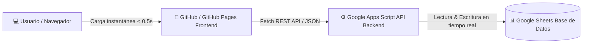

# 🎫 Mesa de Ayuda — Dialimentos

Sistema integral de gestión de tickets de soporte para las áreas de **Mantenimiento**, **Tecnología de la Información (TIC)** y **Recursos Humanos**, conectado directamente a **Google Sheets como base de datos en tiempo real**.

---

## ⚡ Arquitectura Desacoplada de Alto Rendimiento

Para maximizar la velocidad de carga y respuesta de la aplicación, el sistema opera con arquitectura desacoplada:

* **Frontend (GitHub / GitHub Pages):**
  * `index.html`: Estructura semántica moderna y responsiva.
  * `css/styles.css`: Sistema de diseño premium en modo oscuro con efectos *glassmorphism*.
  * `js/app.js`: Lógica del cliente con llamadas asíncronas y reactividad instantánea.
* **Backend & Base de Datos (Google Apps Script + Google Sheets):**
  * `Código.js`: Expone endpoints REST (`doPost` y `doGet`) para autenticación, gestión de tickets, costos, asignaciones y actas técnicas en PDF.
  * Google Sheets actúa como el motor de persistencia centralizado donde se almacenan todos los registros (`TICKET`, `EMPLEADOS`, etc.).

---

## 👥 Perfiles y Credenciales de Acceso

| Perfil | Área | Usuario / Cédula | Contraseña | Alcance y Permisos |
| :--- | :--- | :--- | :--- | :--- |
| **Administradora** | Mantenimiento | `1234` | `123` | **Acceso total a todos los tickets de Mantenimiento**. Gestión exclusiva de **Costo**, **Aprobación**, **Proveedor**, **Consulta** y **Observaciones**. |
| **Coordinador Mantenimiento** | Mantenimiento | Cédula registrada | `mto2026` | Asignación y gestión técnica de tickets de Mantenimiento. |
| **Coordinador TIC** | TIC | Cédula registrada | `tic2026` | Asignación y gestión técnica de tickets de TIC / Sistemas. |
| **Recursos Humanos** | RRHH | Cédula registrada | `rrhh2026` | Gestión y alta de empleados y creación de puntos de servicio. |
| **Técnico** | Asignada | Cédula registrada | — | Atención y cierre formal de tickets con evidencia fotográfica. |
| **Empleado** | Todas | Cédula registrada | — | Creación y seguimiento de solicitudes de soporte. |

---

## 🚀 Despliegue en GitHub Pages (Activación en 1 Clic)

Para tener la aplicación disponible públicamente con un enlace permanente y carga ultra rápida:

1. Ve a tu repositorio en GitHub: `https://github.com/asistentetic-source/Ticket`
2. Haz clic en la pestaña **Settings** (Configuración).
3. En el menú lateral izquierdo, haz clic en **Pages**.
4. En **Build and deployment > Branch**:
   * Selecciona la rama **`main`**.
   * Carpeta: **`/ (root)`**.
5. Haz clic en **Save** (Guardar).
6. En un par de minutos, GitHub te dará el enlace público:
   👉 **`https://asistentetic-source.github.io/Ticket/`**

---

## 🛠️ Tecnologías Utilizadas

* **HTML5 & CSS3 Vanilla:** Interfaz moderna, responsiva y accesible sin sobrecarga de frameworks.
* **JavaScript ES6+:** Comunicación asíncrona mediante Fetch API nativa.
* **Google Apps Script:** Backend serverless en la nube de Google.
* **Google Sheets:** Base de datos relacional/tabular en tiempo real.
* **SheetJS (xlsx):** Procesamiento ultrarrápido de archivos Excel en el cliente.
